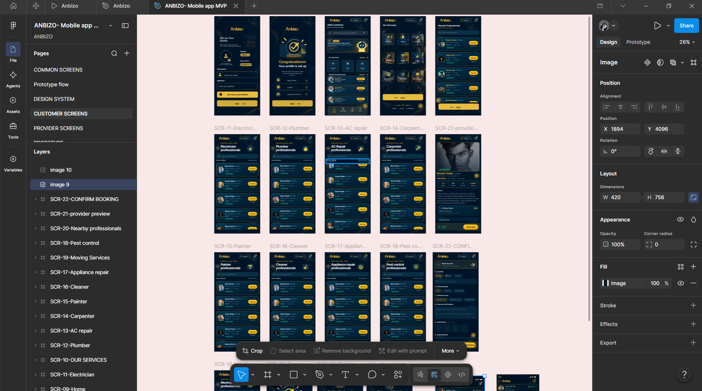
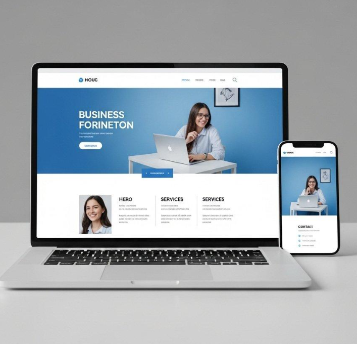
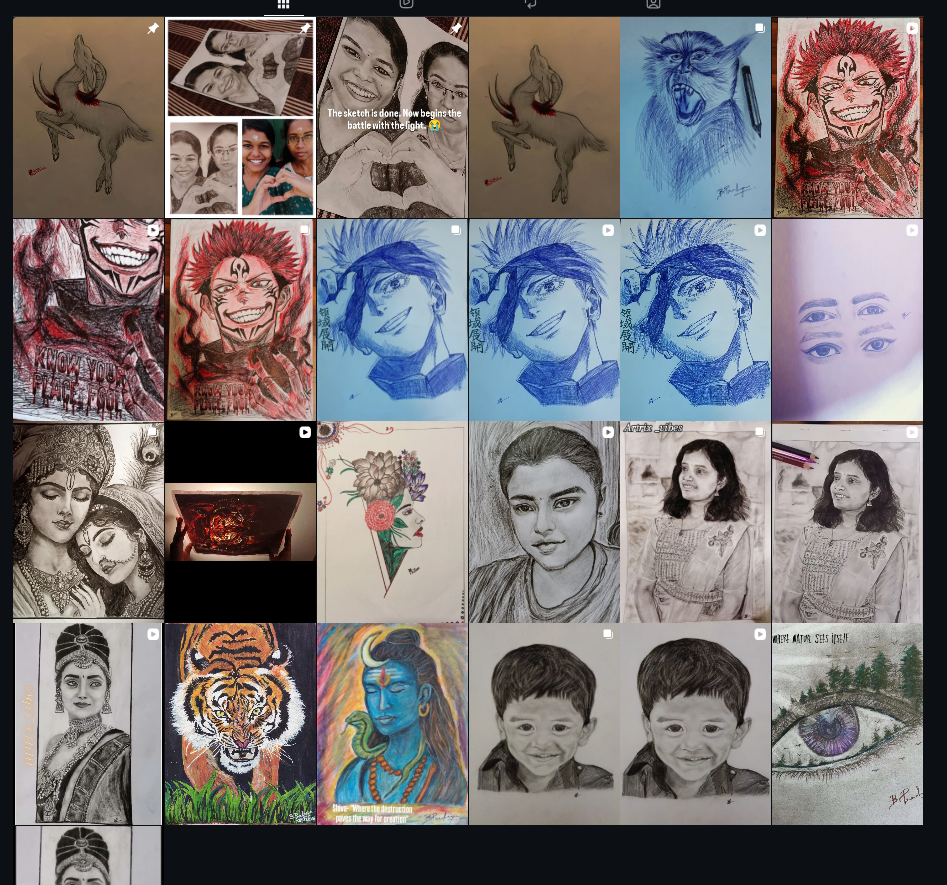

# Ex01 Portfolio
## Date: 30/10/2026

## AIM
To create a Portfolio using HTML and CSS.

## ALGORITHM
### STEP 1
Create an HTML file (index.html)

### STEP 2
Create a CSS file (style.css)

### STEP 3
Include a navigation bar with links to different sections.

### STEP 4
Add structured sections for introduction, about, projects, and contact details.

### STEP 5
Define global styles for fonts, colors, and layout.

### STEP 6
Style the header, navigation bar, and sections.

### STEP 7
Use Flexbox or CSS Grid for layout design.

### STEP 8
Add hover effects and transitions for interactivity.

### STEP 9
Add Images and Media.

### STEP 10
Use optimized images for a professional look.

### STEP 11
Open the HTML file in a browser to check layout and functionality.

### STEP 12
Fix styling issues and refine content placement.

### STEP 13
Deploy the Portfolio.

### STEP 14
Upload to GitHub Pages for free hosting.

## PROGRAM
```

<!DOCTYPE html>
<html lang="en">
<head>
    <meta charset="UTF-8">
    <meta name="viewport" content="width=device-width, initial-scale=1.0">
    <title>My Portfolio | Pradeepa</title>
    <link rel="stylesheet" href="style.css">
</head>

<body>

    <!-- Navigation Bar -->
    <header>
        <nav class="navbar">
            <h2 class="logo">Portfolio<span>.</span></h2>

            <ul class="nav-links">
                <li><a href="#home">Home</a></li>
                <li><a href="#about">About</a></li>
                <li><a href="#skills">Skills</a></li>
                <li><a href="#projects">Projects</a></li>
                <li><a href="#contact">Contact</a></li>
            </ul>
        </nav>
    </header>

    <!-- Home Section -->
    <section id="home" class="home">
        <div class="home-content">
            <p class="welcome">WELCOME TO MY PORTFOLIO</p>

            <h1>Hello, I'm <span>Pradeepa</span></h1>

            <h3>Engineering Student & Creative Designer</h3>

            <p>
                I love exploring technology, creating designs,
                and turning creative ideas into reality.
            </p>

            <a href="#projects" class="btn">Explore My Work</a>
        </div>

        <div class="home-image">
            
        </div>
    </section>

    <!-- About Section -->
    <section id="about" class="section">
        <h2 class="section-title">About Me</h2>

        <div class="about-content">
            <p>
                I am an engineering student passionate about
                technology, programming, UI/UX design, and creativity.

                I enjoy learning new skills, solving problems,
                and developing meaningful digital experiences.
            </p>
        </div>
    </section>

    <!-- Skills Section -->
    <section id="skills" class="section">
        <h2 class="section-title">My Skills</h2>

        <div class="skills-container">
            <div class="skill">HTML</div>
            <div class="skill">CSS</div>
            <div class="skill">C Programming, Python Programming</div>
            <div class="skill">UI/UX Design</div>
            <div class="skill">Figma</div>
            <div class="skill">Creative Design</div>
        </div>
    </section>

    <!-- Projects Section -->
    <section id="projects" class="section">
        <h2 class="section-title">My Projects</h2>

        <div class="projects-container">

            <div class="project-card">
                
                <div class="project-info">
                    <h3>UI/UX Design</h3>
                    <p>A creative and user-friendly app interface design.</p>
                </div>
            </div>

            <div class="project-card">
                
                <div class="project-info">
                    <h3>Web Development</h3>
                    <p>A responsive website created using HTML and CSS.</p>
                </div>
            </div>

            <div class="project-card">
                
                <div class="project-info">
                    <h3>Creative Artwork</h3>
                    <p>A collection of my drawings and digital artwork.</p>
                </div>
            </div>

        </div>
    </section>

    <!-- Contact Section -->
    <section id="contact" class="section contact">
        <h2 class="section-title">Contact Me</h2>

        <p>Let's connect and create something amazing!</p>

        <div class="contact-details">
            <p>Email: pradeepab2323@gmail.com</p>
            <p>GitHub: github.com/Pradeepa-Babu</p>
            <p>LinkedIn: https://www.linkedin.com/in/pradeepa-b-54433437a</p>
        </div>

        <a href="mailto:pradeepab2323@gmail.com" class="btn">
            Send Me an Email
        </a>
    </section>

    <!-- Footer -->
    <footer>
        <p>© 2026 Pradeepa. All Rights Reserved.</p>
    </footer>

</body>
</html>

```

## OUTPUT
c:\Users\acer\OneDrive\Pictures\Screenshots\Screenshot 2026-10-30 203022.png
c:\Users\acer\OneDrive\Pictures\Screenshots\Screenshot 2026-10-30 203058.png
c:\Users\acer\OneDrive\Pictures\Screenshots\Screenshot 2026-10-30 203108.png
c:\Users\acer\OneDrive\Pictures\Screenshots\Screenshot 2026-10-30 203118.png
c:\Users\acer\OneDrive\Pictures\Screenshots\Screenshot 2026-10-30 203126.png
## RESULT
The program for creating Portfolio using HTML and CSS is executed successfully.
